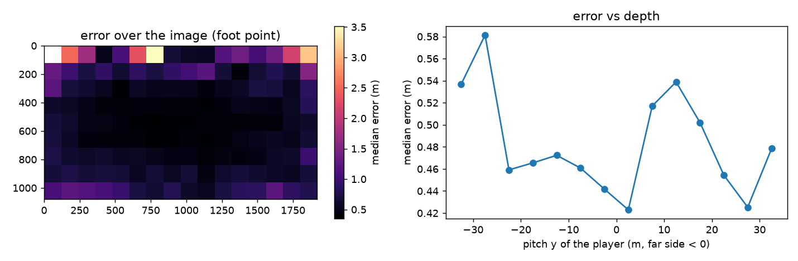

# Calibration report -- valid.parquet

Split valid, 58 clips, propagation on. Error = distance between the projection of the bottom-middle of the GT box and its GT position bbox_pitch.

| frames | from their lines | propagated | global | not calibrated |
|---|---|---|---|---|
| 43500 | 49.1% | 19.1% | 0.0% | 31.8% |

Reasons of failure (a frame may have several):

- no model (fewer than 2 x-lines and 2 y-lines, or RANSAC failed): 6618 frames
- too few inlier points: 6329 frames
- circle points off their circle: 4708 frames
- inliers on fewer than 2 x-lines and 2 y-lines: 413 frames
- mirrored pitch, points above the horizon or implausible bottom of the image: 409 frames
- inliers concentrated in a small region: 144 frames

| subset | players | median error (m) [95 % CI] | p90 (m) | invalid projections |
|---|---|---|---|---|
| all | 502752 | 0.47 [0.44, 0.51] | 1.54 | 0.3% |
| source = lines | 359364 | 0.41 [0.39, 0.45] | 1.27 | 0.2% |
| source = propagated | 143388 | 0.67 [0.60, 0.74] | 2.12 | 0.5% |
| far side (y < -11) | 60911 | 0.53 [0.44, 0.64] | 2.10 | 1.1% |
| middle (-11 <= y < 11) | 284497 | 0.46 [0.43, 0.50] | 1.37 | 0.0% |
| near side (y >= 11) | 157304 | 0.49 [0.42, 0.55] | 1.66 | 0.0% |

Line points of the frames calibrated from their lines: median residual 0.62 px, p90 1.71 px; circle points: 0.17 m from their circle (median).

Temporal stability: median frame-to-frame change of the error of the same player 0.074 m (p90 0.386 m).

