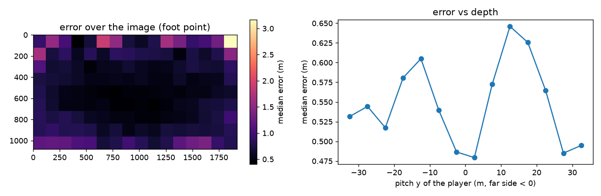

# Calibration report -- valid_model.parquet

Split valid, 58 clips, propagation on. Error = distance between the projection of the bottom-middle of the GT box and its GT position bbox_pitch.

| frames | from their lines | propagated | global | not calibrated |
|---|---|---|---|---|
| 43500 | 65.1% | 19.4% | 0.0% | 15.5% |

Reasons of failure (a frame may have several):

- no model (fewer than 2 x-lines and 2 y-lines, or RANSAC failed): 5480 frames
- circle points off their circle: 1215 frames
- mirrored pitch, points above the horizon or implausible bottom of the image: 302 frames
- moved homography does not fit: 54 frames
- inliers on fewer than 2 x-lines and 2 y-lines: 2 frames
- inliers concentrated in a small region: 2 frames

| subset | players | median error (m) [95 % CI] | p90 (m) | invalid projections |
|---|---|---|---|---|
| all | 622208 | 0.54 [0.50, 0.60] | 1.91 | 0.3% |
| source = lines | 475241 | 0.48 [0.44, 0.52] | 1.59 | 0.2% |
| source = propagated | 146967 | 0.85 [0.74, 1.00] | 2.84 | 0.4% |
| far side (y < -11) | 90108 | 0.59 [0.51, 0.69] | 2.06 | 0.9% |
| middle (-11 <= y < 11) | 346179 | 0.52 [0.47, 0.58] | 1.75 | 0.0% |
| near side (y >= 11) | 185881 | 0.58 [0.51, 0.66] | 2.18 | 0.0% |

Line points of the frames calibrated from their lines: median residual 0.65 px, p90 1.84 px; circle points: 0.17 m from their circle (median).

Temporal stability: median frame-to-frame change of the error of the same player 0.087 m (p90 0.466 m).

