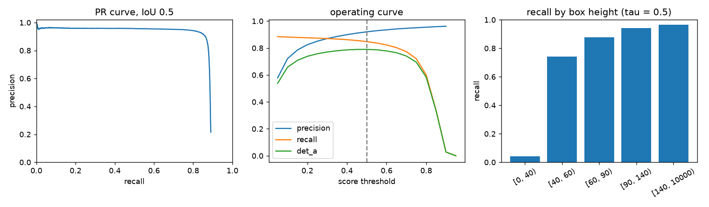

# Detection report -- valid_s5.parquet

Split valid, stride 5, 8700 frames, 58 clips, 149771 ground-truth boxes. Detector: yolo26m.pt at imgsz 1280, tiling False, pitch radius None. Latency 15.9 ms/frame.

| AP50 | AP75 | AP@[.5:.95] |
|---|---|---|
| 0.839 | 0.464 | 0.469 |

Operating point tau = 0.5 (IoU 0.5); 95 % CI by resampling clips:

| precision | recall | DetA |
|---|---|---|
| 0.920 [0.908, 0.932] | 0.848 [0.838, 0.857] | 0.790 [0.777, 0.802] |

## Recall by box height

| height_bin   |   n_gt |   recall |
|:-------------|-------:|---------:|
| [0, 40)      |   9964 |    0.043 |
| [40, 60)     |  11493 |    0.743 |
| [60, 90)     |  48828 |    0.876 |
| [90, 140)    |  64748 |    0.942 |
| [140, 10000) |  14738 |    0.965 |

## Operating curve

|   threshold |         tp |        fp |         fn |   precision |   recall |   det_a |
|------------:|-----------:|----------:|-----------:|------------:|---------:|--------:|
|       0.050 | 132514.000 | 96406.000 |  17257.000 |       0.579 |    0.885 |   0.538 |
|       0.100 | 132016.000 | 50910.000 |  17755.000 |       0.722 |    0.881 |   0.658 |
|       0.150 | 131632.000 | 35972.000 |  18139.000 |       0.785 |    0.879 |   0.709 |
|       0.200 | 131218.000 | 27878.000 |  18553.000 |       0.825 |    0.876 |   0.739 |
|       0.250 | 130820.000 | 22965.000 |  18951.000 |       0.851 |    0.873 |   0.757 |
|       0.300 | 130378.000 | 19442.000 |  19393.000 |       0.870 |    0.871 |   0.770 |
|       0.350 | 129839.000 | 16723.000 |  19932.000 |       0.886 |    0.867 |   0.780 |
|       0.400 | 129127.000 | 14446.000 |  20644.000 |       0.899 |    0.862 |   0.786 |
|       0.450 | 128178.000 | 12559.000 |  21593.000 |       0.911 |    0.856 |   0.790 |
|       0.500 | 126980.000 | 10994.000 |  22791.000 |       0.920 |    0.848 |   0.790 |
|       0.550 | 125426.000 |  9623.000 |  24345.000 |       0.929 |    0.837 |   0.787 |
|       0.600 | 123230.000 |  8547.000 |  26541.000 |       0.935 |    0.823 |   0.778 |
|       0.650 | 120272.000 |  7441.000 |  29499.000 |       0.942 |    0.803 |   0.765 |
|       0.700 | 115796.000 |  6539.000 |  33975.000 |       0.947 |    0.773 |   0.741 |
|       0.750 | 107976.000 |  5589.000 |  41795.000 |       0.951 |    0.721 |   0.695 |
|       0.800 |  89886.000 |  4265.000 |  59885.000 |       0.955 |    0.600 |   0.584 |
|       0.850 |  50718.000 |  2189.000 |  99053.000 |       0.959 |    0.339 |   0.334 |
|       0.900 |   4132.000 |   165.000 | 145639.000 |       0.962 |    0.028 |   0.028 |
|       0.950 |      0.000 |     0.000 | 149771.000 |     nan     |    0.000 |   0.000 |

