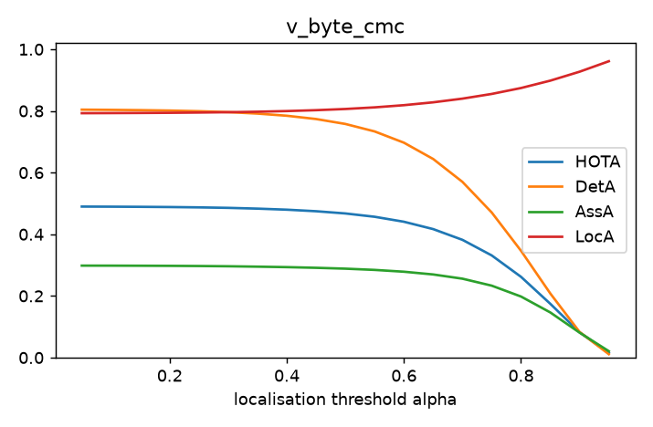

# Tracking report -- v_byte_cmc.parquet

Split valid, 58 clips, oracle detections: False, CMC: True, tracking 1.96 ms/frame. Tracker: `{'motion': 'kalman', 'two_stage': True, 'high_thresh': 0.5, 'low_thresh': 0.1, 'new_track_thresh': 0.6, 'iou_gate_high': 0.2, 'iou_gate_low': 0.5, 'maha_gate': 9.4877, 'n_init': 3, 'max_lost_s': 1.0, 'output': 'filtered'}`.

| HOTA | DetA | AssA | LocA | IDF1 | MOTA | IDSW |
|---|---|---|---|---|---|---|
| 0.389 [0.367, 0.411] | 0.615 [0.604, 0.625] | 0.249 [0.222, 0.276] | 0.831 | 0.395 [0.370, 0.420] | 0.709 | 27099 |

95 % intervals: clips resampled with replacement. HOTA, DetA and AssA are averaged over alpha in {0.05, ..., 0.95}.

## Per clip

| clip     |   HOTA |   DetA |   AssA |   LocA |   DetRe |   DetPr |   IDF1 |   MOTA |   IDSW |
|:---------|-------:|-------:|-------:|-------:|--------:|--------:|-------:|-------:|-------:|
| SNGS-021 |  0.420 |  0.617 |  0.286 |  0.854 |   0.731 |   0.733 |  0.401 |  0.666 |    299 |
| SNGS-022 |  0.371 |  0.616 |  0.225 |  0.808 |   0.659 |   0.772 |  0.397 |  0.739 |    382 |
| SNGS-023 |  0.466 |  0.683 |  0.320 |  0.842 |   0.716 |   0.831 |  0.493 |  0.824 |    321 |
| SNGS-024 |  0.356 |  0.615 |  0.207 |  0.824 |   0.661 |   0.786 |  0.357 |  0.693 |    391 |
| SNGS-025 |  0.374 |  0.617 |  0.228 |  0.839 |   0.698 |   0.755 |  0.346 |  0.717 |    312 |
| SNGS-026 |  0.415 |  0.597 |  0.289 |  0.835 |   0.679 |   0.742 |  0.443 |  0.665 |    493 |
| SNGS-027 |  0.325 |  0.565 |  0.190 |  0.844 |   0.651 |   0.735 |  0.285 |  0.625 |    438 |
| SNGS-028 |  0.337 |  0.533 |  0.214 |  0.824 |   0.656 |   0.661 |  0.361 |  0.551 |    531 |
| SNGS-029 |  0.354 |  0.578 |  0.218 |  0.834 |   0.684 |   0.711 |  0.344 |  0.617 |    346 |
| SNGS-030 |  0.425 |  0.604 |  0.300 |  0.834 |   0.672 |   0.762 |  0.467 |  0.712 |    256 |
| SNGS-031 |  0.371 |  0.614 |  0.226 |  0.817 |   0.666 |   0.770 |  0.376 |  0.734 |    356 |
| SNGS-032 |  0.365 |  0.597 |  0.224 |  0.813 |   0.651 |   0.762 |  0.383 |  0.663 |    424 |
| SNGS-033 |  0.467 |  0.575 |  0.381 |  0.837 |   0.671 |   0.724 |  0.513 |  0.615 |    105 |
| SNGS-034 |  0.398 |  0.641 |  0.249 |  0.855 |   0.680 |   0.831 |  0.401 |  0.750 |    341 |
| SNGS-035 |  0.417 |  0.640 |  0.272 |  0.832 |   0.707 |   0.770 |  0.419 |  0.750 |    301 |
| SNGS-036 |  0.568 |  0.613 |  0.528 |  0.849 |   0.750 |   0.703 |  0.646 |  0.674 |    145 |
| SNGS-037 |  0.376 |  0.620 |  0.229 |  0.842 |   0.703 |   0.756 |  0.371 |  0.685 |    579 |
| SNGS-038 |  0.450 |  0.617 |  0.329 |  0.852 |   0.701 |   0.762 |  0.446 |  0.706 |    205 |
| SNGS-039 |  0.339 |  0.630 |  0.183 |  0.823 |   0.675 |   0.786 |  0.334 |  0.756 |    576 |
| SNGS-040 |  0.267 |  0.526 |  0.136 |  0.819 |   0.560 |   0.778 |  0.276 |  0.609 |    669 |
| SNGS-041 |  0.476 |  0.658 |  0.345 |  0.819 |   0.694 |   0.794 |  0.520 |  0.813 |    295 |
| SNGS-042 |  0.381 |  0.608 |  0.240 |  0.840 |   0.650 |   0.807 |  0.404 |  0.706 |    657 |
| SNGS-043 |  0.299 |  0.574 |  0.157 |  0.816 |   0.614 |   0.778 |  0.299 |  0.658 |    692 |
| SNGS-044 |  0.361 |  0.632 |  0.208 |  0.830 |   0.666 |   0.812 |  0.378 |  0.738 |    627 |
| SNGS-045 |  0.269 |  0.539 |  0.136 |  0.800 |   0.594 |   0.726 |  0.261 |  0.620 |    660 |
| SNGS-046 |  0.329 |  0.596 |  0.182 |  0.815 |   0.639 |   0.778 |  0.348 |  0.691 |    603 |
| SNGS-047 |  0.342 |  0.653 |  0.180 |  0.830 |   0.689 |   0.809 |  0.334 |  0.775 |    596 |
| SNGS-048 |  0.423 |  0.625 |  0.287 |  0.841 |   0.709 |   0.753 |  0.432 |  0.709 |    498 |
| SNGS-049 |  0.409 |  0.615 |  0.274 |  0.808 |   0.664 |   0.761 |  0.476 |  0.745 |    525 |
| SNGS-050 |  0.345 |  0.635 |  0.190 |  0.826 |   0.673 |   0.800 |  0.331 |  0.767 |    624 |
| SNGS-051 |  0.452 |  0.598 |  0.342 |  0.815 |   0.656 |   0.758 |  0.500 |  0.690 |    213 |
| SNGS-052 |  0.336 |  0.625 |  0.182 |  0.833 |   0.676 |   0.789 |  0.321 |  0.707 |    866 |
| SNGS-053 |  0.490 |  0.657 |  0.365 |  0.853 |   0.724 |   0.794 |  0.540 |  0.753 |    402 |
| SNGS-054 |  0.318 |  0.570 |  0.178 |  0.811 |   0.625 |   0.745 |  0.329 |  0.656 |    704 |
| SNGS-055 |  0.358 |  0.625 |  0.206 |  0.839 |   0.659 |   0.821 |  0.351 |  0.719 |    590 |
| SNGS-056 |  0.643 |  0.723 |  0.573 |  0.890 |   0.786 |   0.845 |  0.690 |  0.811 |    111 |
| SNGS-057 |  0.310 |  0.586 |  0.165 |  0.827 |   0.616 |   0.807 |  0.305 |  0.691 |    665 |
| SNGS-058 |  0.334 |  0.577 |  0.194 |  0.825 |   0.646 |   0.745 |  0.360 |  0.639 |    520 |
| SNGS-059 |  0.345 |  0.618 |  0.195 |  0.841 |   0.711 |   0.744 |  0.340 |  0.702 |    495 |
| SNGS-078 |  0.372 |  0.608 |  0.228 |  0.832 |   0.668 |   0.773 |  0.398 |  0.691 |    517 |
| SNGS-079 |  0.285 |  0.536 |  0.153 |  0.812 |   0.573 |   0.770 |  0.295 |  0.617 |    627 |
| SNGS-080 |  0.339 |  0.644 |  0.179 |  0.837 |   0.692 |   0.802 |  0.338 |  0.761 |    403 |
| SNGS-081 |  0.308 |  0.644 |  0.148 |  0.825 |   0.688 |   0.795 |  0.275 |  0.748 |    610 |
| SNGS-082 |  0.305 |  0.624 |  0.150 |  0.806 |   0.667 |   0.767 |  0.293 |  0.748 |    721 |
| SNGS-083 |  0.364 |  0.595 |  0.224 |  0.804 |   0.655 |   0.740 |  0.405 |  0.700 |    557 |
| SNGS-084 |  0.328 |  0.569 |  0.190 |  0.812 |   0.647 |   0.720 |  0.334 |  0.640 |    443 |
| SNGS-085 |  0.370 |  0.703 |  0.197 |  0.855 |   0.731 |   0.851 |  0.358 |  0.814 |    483 |
| SNGS-086 |  0.363 |  0.659 |  0.201 |  0.846 |   0.697 |   0.826 |  0.355 |  0.775 |    424 |
| SNGS-087 |  0.357 |  0.651 |  0.196 |  0.830 |   0.696 |   0.798 |  0.359 |  0.763 |    551 |
| SNGS-088 |  0.382 |  0.614 |  0.238 |  0.816 |   0.682 |   0.747 |  0.416 |  0.721 |    525 |
| SNGS-089 |  0.396 |  0.640 |  0.246 |  0.820 |   0.691 |   0.780 |  0.418 |  0.736 |    463 |
| SNGS-090 |  0.396 |  0.605 |  0.260 |  0.810 |   0.680 |   0.732 |  0.420 |  0.701 |    388 |
| SNGS-091 |  0.335 |  0.553 |  0.204 |  0.799 |   0.649 |   0.680 |  0.353 |  0.602 |    488 |
| SNGS-092 |  0.361 |  0.635 |  0.206 |  0.835 |   0.699 |   0.777 |  0.363 |  0.728 |    413 |
| SNGS-093 |  0.356 |  0.615 |  0.208 |  0.836 |   0.676 |   0.779 |  0.335 |  0.691 |    546 |
| SNGS-094 |  0.387 |  0.670 |  0.224 |  0.845 |   0.728 |   0.801 |  0.388 |  0.769 |    609 |
| SNGS-095 |  0.425 |  0.632 |  0.287 |  0.830 |   0.692 |   0.778 |  0.458 |  0.711 |    392 |
| SNGS-096 |  0.593 |  0.640 |  0.550 |  0.854 |   0.768 |   0.728 |  0.673 |  0.698 |    126 |

