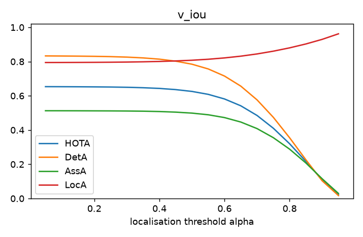

# Tracking report -- v_iou.parquet

Split valid, 58 clips, oracle detections: False, CMC: False, tracking 0.19 ms/frame. Tracker: `{'motion': 'none', 'two_stage': False, 'high_thresh': 0.5, 'low_thresh': 0.1, 'new_track_thresh': 0.6, 'iou_gate_high': 0.2, 'iou_gate_low': 0.5, 'maha_gate': 9.4877, 'n_init': 3, 'max_lost_s': 1.0, 'output': 'filtered'}`.

| HOTA | DetA | AssA | LocA | IDF1 | MOTA | IDSW |
|---|---|---|---|---|---|---|
| 0.514 [0.494, 0.535] | 0.636 [0.626, 0.647] | 0.416 [0.387, 0.448] | 0.833 | 0.577 [0.552, 0.605] | 0.772 | 4587 |

95 % intervals: clips resampled with replacement. HOTA, DetA and AssA are averaged over alpha in {0.05, ..., 0.95}.

## Per clip

| clip     |   HOTA |   DetA |   AssA |   LocA |   DetRe |   DetPr |   IDF1 |   MOTA |   IDSW |
|:---------|-------:|-------:|-------:|-------:|--------:|--------:|-------:|-------:|-------:|
| SNGS-021 |  0.576 |  0.645 |  0.514 |  0.857 |   0.753 |   0.752 |  0.637 |  0.729 |     44 |
| SNGS-022 |  0.530 |  0.643 |  0.437 |  0.811 |   0.685 |   0.780 |  0.647 |  0.802 |     93 |
| SNGS-023 |  0.560 |  0.696 |  0.452 |  0.847 |   0.733 |   0.834 |  0.620 |  0.853 |     83 |
| SNGS-024 |  0.512 |  0.639 |  0.411 |  0.827 |   0.685 |   0.794 |  0.592 |  0.768 |    101 |
| SNGS-025 |  0.464 |  0.640 |  0.337 |  0.840 |   0.715 |   0.770 |  0.478 |  0.770 |     90 |
| SNGS-026 |  0.589 |  0.648 |  0.535 |  0.837 |   0.721 |   0.773 |  0.679 |  0.791 |     35 |
| SNGS-027 |  0.402 |  0.599 |  0.271 |  0.848 |   0.666 |   0.778 |  0.394 |  0.708 |    168 |
| SNGS-028 |  0.522 |  0.601 |  0.454 |  0.822 |   0.706 |   0.708 |  0.593 |  0.725 |     37 |
| SNGS-029 |  0.485 |  0.604 |  0.390 |  0.846 |   0.706 |   0.736 |  0.545 |  0.679 |     92 |
| SNGS-030 |  0.528 |  0.625 |  0.448 |  0.833 |   0.680 |   0.783 |  0.620 |  0.772 |     64 |
| SNGS-031 |  0.490 |  0.632 |  0.381 |  0.820 |   0.683 |   0.777 |  0.559 |  0.783 |     78 |
| SNGS-032 |  0.443 |  0.608 |  0.323 |  0.820 |   0.656 |   0.780 |  0.488 |  0.724 |    105 |
| SNGS-033 |  0.484 |  0.569 |  0.413 |  0.847 |   0.653 |   0.746 |  0.559 |  0.628 |     65 |
| SNGS-034 |  0.449 |  0.654 |  0.309 |  0.860 |   0.686 |   0.848 |  0.469 |  0.779 |     90 |
| SNGS-035 |  0.489 |  0.658 |  0.364 |  0.835 |   0.720 |   0.785 |  0.532 |  0.800 |     75 |
| SNGS-036 |  0.658 |  0.607 |  0.713 |  0.849 |   0.747 |   0.701 |  0.795 |  0.679 |     17 |
| SNGS-037 |  0.475 |  0.671 |  0.337 |  0.845 |   0.736 |   0.795 |  0.500 |  0.813 |     60 |
| SNGS-038 |  0.575 |  0.663 |  0.502 |  0.858 |   0.712 |   0.825 |  0.626 |  0.789 |     64 |
| SNGS-039 |  0.448 |  0.637 |  0.316 |  0.822 |   0.685 |   0.783 |  0.494 |  0.796 |     93 |
| SNGS-040 |  0.388 |  0.542 |  0.278 |  0.819 |   0.579 |   0.778 |  0.455 |  0.667 |    134 |
| SNGS-041 |  0.634 |  0.673 |  0.599 |  0.823 |   0.710 |   0.799 |  0.765 |  0.849 |     30 |
| SNGS-042 |  0.456 |  0.609 |  0.342 |  0.839 |   0.651 |   0.806 |  0.513 |  0.746 |    104 |
| SNGS-043 |  0.430 |  0.596 |  0.311 |  0.817 |   0.639 |   0.780 |  0.481 |  0.731 |    127 |
| SNGS-044 |  0.485 |  0.641 |  0.367 |  0.832 |   0.678 |   0.811 |  0.573 |  0.787 |     94 |
| SNGS-045 |  0.404 |  0.577 |  0.284 |  0.801 |   0.637 |   0.729 |  0.435 |  0.720 |     96 |
| SNGS-046 |  0.519 |  0.620 |  0.436 |  0.816 |   0.667 |   0.777 |  0.623 |  0.769 |     82 |
| SNGS-047 |  0.578 |  0.675 |  0.495 |  0.828 |   0.715 |   0.807 |  0.698 |  0.851 |     56 |
| SNGS-048 |  0.576 |  0.642 |  0.516 |  0.841 |   0.724 |   0.762 |  0.661 |  0.767 |     45 |
| SNGS-049 |  0.527 |  0.626 |  0.446 |  0.806 |   0.677 |   0.759 |  0.658 |  0.797 |     50 |
| SNGS-050 |  0.465 |  0.643 |  0.337 |  0.826 |   0.680 |   0.803 |  0.499 |  0.809 |    116 |
| SNGS-051 |  0.551 |  0.603 |  0.504 |  0.814 |   0.659 |   0.760 |  0.709 |  0.725 |     33 |
| SNGS-052 |  0.521 |  0.659 |  0.413 |  0.835 |   0.705 |   0.805 |  0.618 |  0.812 |     67 |
| SNGS-053 |  0.681 |  0.673 |  0.688 |  0.851 |   0.741 |   0.795 |  0.821 |  0.801 |     19 |
| SNGS-054 |  0.486 |  0.611 |  0.387 |  0.809 |   0.665 |   0.757 |  0.569 |  0.766 |     90 |
| SNGS-055 |  0.436 |  0.647 |  0.294 |  0.840 |   0.687 |   0.818 |  0.462 |  0.785 |    113 |
| SNGS-056 |  0.737 |  0.750 |  0.726 |  0.891 |   0.801 |   0.867 |  0.840 |  0.854 |     13 |
| SNGS-057 |  0.422 |  0.614 |  0.291 |  0.829 |   0.648 |   0.807 |  0.445 |  0.755 |    156 |
| SNGS-058 |  0.402 |  0.593 |  0.273 |  0.828 |   0.659 |   0.757 |  0.433 |  0.708 |    115 |
| SNGS-059 |  0.519 |  0.650 |  0.416 |  0.845 |   0.746 |   0.755 |  0.565 |  0.778 |     42 |
| SNGS-078 |  0.472 |  0.654 |  0.340 |  0.839 |   0.703 |   0.804 |  0.539 |  0.801 |     79 |
| SNGS-079 |  0.379 |  0.544 |  0.265 |  0.816 |   0.581 |   0.776 |  0.459 |  0.676 |    156 |
| SNGS-080 |  0.488 |  0.682 |  0.350 |  0.843 |   0.726 |   0.821 |  0.531 |  0.835 |     72 |
| SNGS-081 |  0.452 |  0.679 |  0.302 |  0.830 |   0.727 |   0.801 |  0.477 |  0.830 |     94 |
| SNGS-082 |  0.447 |  0.644 |  0.310 |  0.802 |   0.692 |   0.760 |  0.484 |  0.828 |     74 |
| SNGS-083 |  0.493 |  0.618 |  0.394 |  0.807 |   0.674 |   0.753 |  0.573 |  0.777 |     83 |
| SNGS-084 |  0.411 |  0.582 |  0.291 |  0.820 |   0.651 |   0.742 |  0.444 |  0.693 |    141 |
| SNGS-085 |  0.621 |  0.741 |  0.523 |  0.866 |   0.774 |   0.863 |  0.659 |  0.880 |     47 |
| SNGS-086 |  0.466 |  0.684 |  0.318 |  0.854 |   0.727 |   0.834 |  0.490 |  0.819 |    129 |
| SNGS-087 |  0.615 |  0.683 |  0.553 |  0.835 |   0.736 |   0.802 |  0.751 |  0.846 |     35 |
| SNGS-088 |  0.523 |  0.634 |  0.431 |  0.818 |   0.705 |   0.750 |  0.632 |  0.786 |     75 |
| SNGS-089 |  0.540 |  0.659 |  0.443 |  0.823 |   0.713 |   0.784 |  0.625 |  0.797 |     63 |
| SNGS-090 |  0.441 |  0.626 |  0.311 |  0.812 |   0.696 |   0.744 |  0.466 |  0.761 |     77 |
| SNGS-091 |  0.520 |  0.569 |  0.475 |  0.801 |   0.664 |   0.689 |  0.610 |  0.670 |     60 |
| SNGS-092 |  0.521 |  0.657 |  0.414 |  0.842 |   0.724 |   0.786 |  0.590 |  0.782 |     71 |
| SNGS-093 |  0.471 |  0.643 |  0.346 |  0.839 |   0.698 |   0.796 |  0.491 |  0.777 |     88 |
| SNGS-094 |  0.584 |  0.695 |  0.492 |  0.848 |   0.760 |   0.801 |  0.661 |  0.843 |     51 |
| SNGS-095 |  0.572 |  0.664 |  0.493 |  0.835 |   0.718 |   0.797 |  0.668 |  0.785 |     68 |
| SNGS-096 |  0.548 |  0.628 |  0.479 |  0.859 |   0.748 |   0.734 |  0.626 |  0.687 |     88 |

