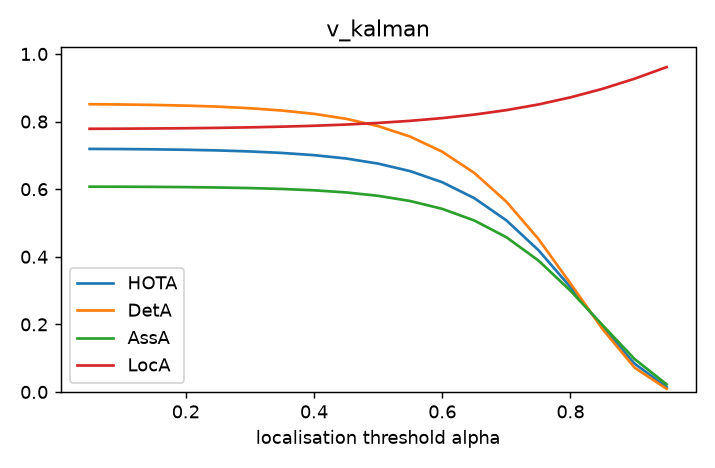

# Tracking report -- v_kalman.parquet

Split valid, 58 clips, oracle detections: False, CMC: False, tracking 0.90 ms/frame. Tracker: `{'motion': 'kalman', 'two_stage': True, 'high_thresh': 0.5, 'low_thresh': 0.1, 'new_track_thresh': 0.6, 'iou_gate_high': 0.2, 'iou_gate_low': 0.5, 'maha_gate': None, 'n_init': 3, 'max_lost_s': 1.0, 'output': 'filtered'}`.

| HOTA | DetA | AssA | LocA | IDF1 | MOTA | IDSW |
|---|---|---|---|---|---|---|
| 0.550 [0.533, 0.569] | 0.634 [0.625, 0.644] | 0.478 [0.452, 0.506] | 0.822 | 0.639 [0.613, 0.665] | 0.773 | 2529 |

95 % intervals: clips resampled with replacement. HOTA, DetA and AssA are averaged over alpha in {0.05, ..., 0.95}.

## Per clip

| clip     |   HOTA |   DetA |   AssA |   LocA |   DetRe |   DetPr |   IDF1 |   MOTA |   IDSW |
|:---------|-------:|-------:|-------:|-------:|--------:|--------:|-------:|-------:|-------:|
| SNGS-021 |  0.548 |  0.622 |  0.483 |  0.844 |   0.745 |   0.719 |  0.605 |  0.693 |     43 |
| SNGS-022 |  0.555 |  0.628 |  0.490 |  0.797 |   0.676 |   0.755 |  0.703 |  0.788 |     36 |
| SNGS-023 |  0.575 |  0.692 |  0.481 |  0.834 |   0.731 |   0.815 |  0.650 |  0.857 |     64 |
| SNGS-024 |  0.572 |  0.636 |  0.515 |  0.812 |   0.689 |   0.769 |  0.690 |  0.778 |     23 |
| SNGS-025 |  0.504 |  0.614 |  0.416 |  0.827 |   0.708 |   0.730 |  0.540 |  0.754 |     55 |
| SNGS-026 |  0.604 |  0.629 |  0.579 |  0.829 |   0.721 |   0.737 |  0.732 |  0.762 |     20 |
| SNGS-027 |  0.428 |  0.577 |  0.320 |  0.833 |   0.679 |   0.712 |  0.453 |  0.676 |    124 |
| SNGS-028 |  0.507 |  0.554 |  0.464 |  0.812 |   0.701 |   0.640 |  0.601 |  0.641 |     32 |
| SNGS-029 |  0.483 |  0.571 |  0.409 |  0.819 |   0.690 |   0.683 |  0.558 |  0.620 |     47 |
| SNGS-030 |  0.530 |  0.606 |  0.465 |  0.824 |   0.682 |   0.744 |  0.640 |  0.755 |     47 |
| SNGS-031 |  0.494 |  0.612 |  0.400 |  0.803 |   0.670 |   0.746 |  0.576 |  0.748 |     61 |
| SNGS-032 |  0.460 |  0.587 |  0.362 |  0.793 |   0.646 |   0.729 |  0.519 |  0.683 |     58 |
| SNGS-033 |  0.464 |  0.537 |  0.403 |  0.818 |   0.634 |   0.691 |  0.543 |  0.568 |     67 |
| SNGS-034 |  0.490 |  0.641 |  0.376 |  0.847 |   0.698 |   0.799 |  0.523 |  0.766 |     78 |
| SNGS-035 |  0.515 |  0.642 |  0.414 |  0.818 |   0.710 |   0.756 |  0.594 |  0.792 |     41 |
| SNGS-036 |  0.661 |  0.606 |  0.722 |  0.843 |   0.750 |   0.691 |  0.803 |  0.682 |      9 |
| SNGS-037 |  0.510 |  0.642 |  0.405 |  0.833 |   0.732 |   0.747 |  0.572 |  0.767 |     44 |
| SNGS-038 |  0.564 |  0.632 |  0.505 |  0.844 |   0.721 |   0.756 |  0.620 |  0.750 |     42 |
| SNGS-039 |  0.461 |  0.650 |  0.328 |  0.815 |   0.702 |   0.773 |  0.522 |  0.816 |     61 |
| SNGS-040 |  0.513 |  0.593 |  0.445 |  0.811 |   0.641 |   0.762 |  0.627 |  0.754 |     51 |
| SNGS-041 |  0.674 |  0.680 |  0.668 |  0.816 |   0.721 |   0.788 |  0.848 |  0.872 |     12 |
| SNGS-042 |  0.543 |  0.648 |  0.455 |  0.833 |   0.701 |   0.793 |  0.641 |  0.800 |     51 |
| SNGS-043 |  0.533 |  0.620 |  0.459 |  0.806 |   0.670 |   0.762 |  0.661 |  0.778 |     41 |
| SNGS-044 |  0.578 |  0.654 |  0.512 |  0.821 |   0.695 |   0.793 |  0.710 |  0.823 |     33 |
| SNGS-045 |  0.470 |  0.603 |  0.366 |  0.797 |   0.668 |   0.727 |  0.521 |  0.759 |     42 |
| SNGS-046 |  0.569 |  0.634 |  0.511 |  0.809 |   0.683 |   0.769 |  0.690 |  0.780 |     31 |
| SNGS-047 |  0.611 |  0.699 |  0.534 |  0.825 |   0.741 |   0.802 |  0.748 |  0.884 |     34 |
| SNGS-048 |  0.638 |  0.645 |  0.630 |  0.835 |   0.738 |   0.746 |  0.765 |  0.772 |     13 |
| SNGS-049 |  0.631 |  0.645 |  0.616 |  0.803 |   0.703 |   0.753 |  0.825 |  0.824 |     25 |
| SNGS-050 |  0.508 |  0.672 |  0.386 |  0.820 |   0.716 |   0.791 |  0.576 |  0.850 |     62 |
| SNGS-051 |  0.571 |  0.600 |  0.543 |  0.806 |   0.667 |   0.737 |  0.736 |  0.696 |     16 |
| SNGS-052 |  0.603 |  0.666 |  0.545 |  0.825 |   0.724 |   0.780 |  0.732 |  0.821 |     34 |
| SNGS-053 |  0.678 |  0.673 |  0.683 |  0.848 |   0.744 |   0.788 |  0.808 |  0.803 |     11 |
| SNGS-054 |  0.595 |  0.630 |  0.562 |  0.806 |   0.696 |   0.742 |  0.753 |  0.799 |     25 |
| SNGS-055 |  0.520 |  0.668 |  0.406 |  0.828 |   0.711 |   0.803 |  0.558 |  0.838 |     45 |
| SNGS-056 |  0.738 |  0.731 |  0.745 |  0.886 |   0.803 |   0.836 |  0.832 |  0.834 |      9 |
| SNGS-057 |  0.490 |  0.636 |  0.380 |  0.816 |   0.673 |   0.790 |  0.531 |  0.801 |     59 |
| SNGS-058 |  0.533 |  0.605 |  0.469 |  0.812 |   0.687 |   0.725 |  0.635 |  0.724 |     34 |
| SNGS-059 |  0.599 |  0.647 |  0.555 |  0.838 |   0.750 |   0.740 |  0.683 |  0.773 |     25 |
| SNGS-078 |  0.498 |  0.638 |  0.390 |  0.821 |   0.694 |   0.772 |  0.578 |  0.784 |     45 |
| SNGS-079 |  0.439 |  0.563 |  0.344 |  0.806 |   0.607 |   0.758 |  0.520 |  0.687 |     78 |
| SNGS-080 |  0.501 |  0.661 |  0.380 |  0.824 |   0.715 |   0.783 |  0.569 |  0.818 |     44 |
| SNGS-081 |  0.484 |  0.660 |  0.355 |  0.813 |   0.713 |   0.773 |  0.519 |  0.814 |     54 |
| SNGS-082 |  0.481 |  0.650 |  0.356 |  0.800 |   0.700 |   0.757 |  0.541 |  0.820 |     63 |
| SNGS-083 |  0.527 |  0.617 |  0.451 |  0.799 |   0.686 |   0.730 |  0.616 |  0.755 |     36 |
| SNGS-084 |  0.443 |  0.595 |  0.331 |  0.806 |   0.678 |   0.716 |  0.505 |  0.714 |     68 |
| SNGS-085 |  0.637 |  0.720 |  0.564 |  0.844 |   0.756 |   0.833 |  0.729 |  0.881 |     30 |
| SNGS-086 |  0.537 |  0.668 |  0.432 |  0.832 |   0.722 |   0.795 |  0.623 |  0.819 |     77 |
| SNGS-087 |  0.611 |  0.674 |  0.553 |  0.822 |   0.728 |   0.784 |  0.735 |  0.838 |     22 |
| SNGS-088 |  0.572 |  0.629 |  0.521 |  0.809 |   0.705 |   0.734 |  0.715 |  0.786 |     47 |
| SNGS-089 |  0.528 |  0.651 |  0.429 |  0.812 |   0.708 |   0.767 |  0.622 |  0.793 |     41 |
| SNGS-090 |  0.467 |  0.605 |  0.361 |  0.803 |   0.691 |   0.713 |  0.508 |  0.729 |     51 |
| SNGS-091 |  0.532 |  0.569 |  0.499 |  0.793 |   0.672 |   0.672 |  0.632 |  0.655 |     31 |
| SNGS-092 |  0.512 |  0.643 |  0.409 |  0.824 |   0.715 |   0.761 |  0.582 |  0.775 |     52 |
| SNGS-093 |  0.515 |  0.641 |  0.415 |  0.829 |   0.709 |   0.770 |  0.547 |  0.780 |     47 |
| SNGS-094 |  0.625 |  0.690 |  0.566 |  0.836 |   0.756 |   0.786 |  0.720 |  0.849 |     24 |
| SNGS-095 |  0.596 |  0.650 |  0.548 |  0.824 |   0.716 |   0.769 |  0.704 |  0.775 |     26 |
| SNGS-096 |  0.543 |  0.627 |  0.471 |  0.846 |   0.756 |   0.716 |  0.634 |  0.690 |     88 |

