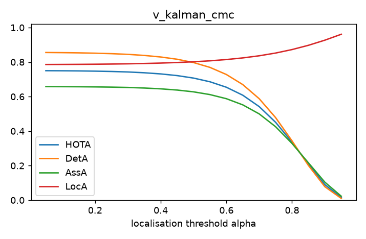

# Tracking report -- v_kalman_cmc.parquet

Split valid, 58 clips, oracle detections: False, CMC: True, tracking 1.15 ms/frame. Tracker: `{'motion': 'kalman', 'two_stage': True, 'high_thresh': 0.5, 'low_thresh': 0.1, 'new_track_thresh': 0.6, 'iou_gate_high': 0.2, 'iou_gate_low': 0.5, 'maha_gate': None, 'n_init': 3, 'max_lost_s': 1.0, 'output': 'filtered'}`.

| HOTA | DetA | AssA | LocA | IDF1 | MOTA | IDSW |
|---|---|---|---|---|---|---|
| 0.578 [0.562, 0.594] | 0.645 [0.636, 0.654] | 0.518 [0.493, 0.545] | 0.827 | 0.675 [0.652, 0.700] | 0.785 | 2007 |

95 % intervals: clips resampled with replacement. HOTA, DetA and AssA are averaged over alpha in {0.05, ..., 0.95}.

## Per clip

| clip     |   HOTA |   DetA |   AssA |   LocA |   DetRe |   DetPr |   IDF1 |   MOTA |   IDSW |
|:---------|-------:|-------:|-------:|-------:|--------:|--------:|-------:|-------:|-------:|
| SNGS-021 |  0.599 |  0.637 |  0.564 |  0.851 |   0.760 |   0.729 |  0.674 |  0.710 |     21 |
| SNGS-022 |  0.567 |  0.645 |  0.499 |  0.806 |   0.694 |   0.767 |  0.711 |  0.810 |     37 |
| SNGS-023 |  0.615 |  0.697 |  0.545 |  0.837 |   0.737 |   0.819 |  0.696 |  0.863 |     48 |
| SNGS-024 |  0.572 |  0.656 |  0.498 |  0.821 |   0.710 |   0.782 |  0.669 |  0.789 |     23 |
| SNGS-025 |  0.542 |  0.629 |  0.467 |  0.834 |   0.725 |   0.739 |  0.591 |  0.759 |     48 |
| SNGS-026 |  0.616 |  0.629 |  0.603 |  0.832 |   0.725 |   0.735 |  0.731 |  0.756 |     15 |
| SNGS-027 |  0.432 |  0.581 |  0.323 |  0.836 |   0.686 |   0.712 |  0.451 |  0.674 |    130 |
| SNGS-028 |  0.539 |  0.562 |  0.516 |  0.820 |   0.715 |   0.645 |  0.626 |  0.643 |     24 |
| SNGS-029 |  0.507 |  0.599 |  0.430 |  0.829 |   0.718 |   0.701 |  0.580 |  0.673 |     39 |
| SNGS-030 |  0.557 |  0.618 |  0.502 |  0.829 |   0.693 |   0.754 |  0.660 |  0.756 |     37 |
| SNGS-031 |  0.547 |  0.644 |  0.466 |  0.813 |   0.703 |   0.761 |  0.650 |  0.792 |     39 |
| SNGS-032 |  0.532 |  0.626 |  0.453 |  0.809 |   0.684 |   0.757 |  0.608 |  0.739 |     37 |
| SNGS-033 |  0.524 |  0.581 |  0.473 |  0.833 |   0.686 |   0.714 |  0.596 |  0.629 |     28 |
| SNGS-034 |  0.524 |  0.646 |  0.426 |  0.850 |   0.702 |   0.803 |  0.570 |  0.774 |     58 |
| SNGS-035 |  0.574 |  0.660 |  0.500 |  0.829 |   0.732 |   0.767 |  0.667 |  0.799 |     29 |
| SNGS-036 |  0.672 |  0.613 |  0.737 |  0.847 |   0.759 |   0.695 |  0.815 |  0.686 |     10 |
| SNGS-037 |  0.597 |  0.649 |  0.549 |  0.837 |   0.743 |   0.749 |  0.693 |  0.781 |     25 |
| SNGS-038 |  0.553 |  0.629 |  0.488 |  0.847 |   0.726 |   0.748 |  0.617 |  0.745 |     35 |
| SNGS-039 |  0.559 |  0.662 |  0.472 |  0.818 |   0.713 |   0.780 |  0.652 |  0.839 |     48 |
| SNGS-040 |  0.538 |  0.602 |  0.481 |  0.812 |   0.650 |   0.765 |  0.677 |  0.759 |     42 |
| SNGS-041 |  0.679 |  0.683 |  0.674 |  0.816 |   0.725 |   0.787 |  0.855 |  0.874 |     10 |
| SNGS-042 |  0.597 |  0.647 |  0.552 |  0.835 |   0.706 |   0.786 |  0.740 |  0.799 |     33 |
| SNGS-043 |  0.580 |  0.629 |  0.536 |  0.810 |   0.679 |   0.767 |  0.723 |  0.789 |     39 |
| SNGS-044 |  0.594 |  0.662 |  0.534 |  0.824 |   0.704 |   0.798 |  0.734 |  0.826 |     32 |
| SNGS-045 |  0.482 |  0.604 |  0.385 |  0.797 |   0.670 |   0.726 |  0.530 |  0.760 |     41 |
| SNGS-046 |  0.585 |  0.640 |  0.536 |  0.813 |   0.689 |   0.775 |  0.717 |  0.785 |     30 |
| SNGS-047 |  0.635 |  0.701 |  0.575 |  0.827 |   0.744 |   0.803 |  0.782 |  0.884 |     30 |
| SNGS-048 |  0.658 |  0.652 |  0.664 |  0.838 |   0.745 |   0.751 |  0.792 |  0.778 |     11 |
| SNGS-049 |  0.636 |  0.652 |  0.622 |  0.805 |   0.708 |   0.758 |  0.832 |  0.837 |     24 |
| SNGS-050 |  0.540 |  0.673 |  0.435 |  0.822 |   0.718 |   0.792 |  0.629 |  0.854 |     60 |
| SNGS-051 |  0.591 |  0.621 |  0.562 |  0.812 |   0.686 |   0.751 |  0.754 |  0.736 |     14 |
| SNGS-052 |  0.607 |  0.679 |  0.544 |  0.829 |   0.737 |   0.786 |  0.750 |  0.840 |     19 |
| SNGS-053 |  0.682 |  0.678 |  0.686 |  0.851 |   0.749 |   0.793 |  0.800 |  0.805 |     11 |
| SNGS-054 |  0.575 |  0.631 |  0.524 |  0.807 |   0.697 |   0.742 |  0.725 |  0.799 |     28 |
| SNGS-055 |  0.522 |  0.672 |  0.406 |  0.832 |   0.717 |   0.806 |  0.554 |  0.837 |     47 |
| SNGS-056 |  0.751 |  0.733 |  0.770 |  0.886 |   0.804 |   0.837 |  0.852 |  0.835 |      8 |
| SNGS-057 |  0.502 |  0.644 |  0.394 |  0.819 |   0.681 |   0.794 |  0.545 |  0.809 |     56 |
| SNGS-058 |  0.553 |  0.620 |  0.493 |  0.821 |   0.703 |   0.738 |  0.647 |  0.738 |     33 |
| SNGS-059 |  0.580 |  0.650 |  0.518 |  0.839 |   0.752 |   0.742 |  0.641 |  0.780 |     27 |
| SNGS-078 |  0.559 |  0.646 |  0.483 |  0.828 |   0.714 |   0.767 |  0.679 |  0.789 |     27 |
| SNGS-079 |  0.493 |  0.588 |  0.415 |  0.809 |   0.632 |   0.767 |  0.587 |  0.721 |     53 |
| SNGS-080 |  0.493 |  0.670 |  0.363 |  0.832 |   0.729 |   0.787 |  0.541 |  0.824 |     44 |
| SNGS-081 |  0.516 |  0.683 |  0.391 |  0.822 |   0.733 |   0.792 |  0.549 |  0.841 |     40 |
| SNGS-082 |  0.565 |  0.666 |  0.480 |  0.807 |   0.717 |   0.766 |  0.671 |  0.840 |     44 |
| SNGS-083 |  0.580 |  0.623 |  0.540 |  0.803 |   0.696 |   0.731 |  0.716 |  0.778 |     27 |
| SNGS-084 |  0.459 |  0.602 |  0.350 |  0.810 |   0.689 |   0.719 |  0.520 |  0.717 |     61 |
| SNGS-085 |  0.652 |  0.727 |  0.585 |  0.847 |   0.761 |   0.838 |  0.744 |  0.883 |     28 |
| SNGS-086 |  0.566 |  0.684 |  0.470 |  0.838 |   0.735 |   0.806 |  0.668 |  0.830 |     58 |
| SNGS-087 |  0.620 |  0.688 |  0.558 |  0.827 |   0.738 |   0.795 |  0.739 |  0.858 |     22 |
| SNGS-088 |  0.577 |  0.639 |  0.521 |  0.814 |   0.717 |   0.739 |  0.714 |  0.792 |     31 |
| SNGS-089 |  0.542 |  0.660 |  0.445 |  0.816 |   0.717 |   0.773 |  0.639 |  0.801 |     37 |
| SNGS-090 |  0.498 |  0.626 |  0.397 |  0.808 |   0.709 |   0.727 |  0.550 |  0.758 |     35 |
| SNGS-091 |  0.538 |  0.577 |  0.502 |  0.797 |   0.682 |   0.678 |  0.642 |  0.668 |     24 |
| SNGS-092 |  0.577 |  0.663 |  0.502 |  0.831 |   0.734 |   0.772 |  0.690 |  0.794 |     34 |
| SNGS-093 |  0.522 |  0.642 |  0.425 |  0.832 |   0.713 |   0.770 |  0.555 |  0.773 |     46 |
| SNGS-094 |  0.638 |  0.700 |  0.582 |  0.842 |   0.764 |   0.794 |  0.729 |  0.852 |     26 |
| SNGS-095 |  0.600 |  0.658 |  0.549 |  0.828 |   0.722 |   0.776 |  0.702 |  0.779 |     26 |
| SNGS-096 |  0.672 |  0.648 |  0.696 |  0.852 |   0.780 |   0.726 |  0.796 |  0.712 |     18 |

