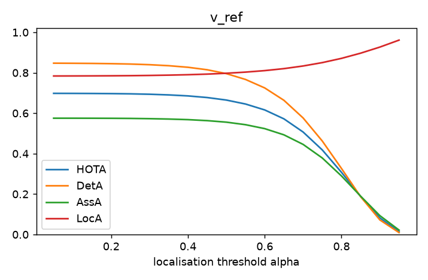

# Tracking report -- v_ref.parquet

Split valid, 58 clips, oracle detections: False, CMC: False, tracking nan ms/frame. Tracker: `{'reference': 'ultralytics BYTETracker', 'motion': 'kalman', 'two_stage': True, 'high_thresh': 0.5, 'low_thresh': 0.1, 'new_track_thresh': 0.6, 'iou_gate_high': 0.2, 'iou_gate_low': 0.5, 'maha_gate': 9.4877, 'n_init': 3, 'max_lost_s': 1.0, 'output': 'filtered'}`.

| HOTA | DetA | AssA | LocA | IDF1 | MOTA | IDSW |
|---|---|---|---|---|---|---|
| 0.539 [0.522, 0.557] | 0.638 [0.629, 0.648] | 0.457 [0.432, 0.485] | 0.824 | 0.618 [0.593, 0.643] | 0.782 | 3012 |

95 % intervals: clips resampled with replacement. HOTA, DetA and AssA are averaged over alpha in {0.05, ..., 0.95}.

## Per clip

| clip     |   HOTA |   DetA |   AssA |   LocA |   DetRe |   DetPr |   IDF1 |   MOTA |   IDSW |
|:---------|-------:|-------:|-------:|-------:|--------:|--------:|-------:|-------:|-------:|
| SNGS-021 |  0.535 |  0.626 |  0.457 |  0.847 |   0.748 |   0.723 |  0.580 |  0.708 |     44 |
| SNGS-022 |  0.566 |  0.640 |  0.501 |  0.805 |   0.681 |   0.773 |  0.719 |  0.804 |     46 |
| SNGS-023 |  0.558 |  0.694 |  0.452 |  0.836 |   0.732 |   0.819 |  0.624 |  0.859 |     74 |
| SNGS-024 |  0.546 |  0.638 |  0.469 |  0.819 |   0.686 |   0.782 |  0.648 |  0.786 |     47 |
| SNGS-025 |  0.519 |  0.632 |  0.428 |  0.831 |   0.717 |   0.749 |  0.543 |  0.768 |     69 |
| SNGS-026 |  0.612 |  0.632 |  0.594 |  0.829 |   0.723 |   0.739 |  0.737 |  0.763 |     19 |
| SNGS-027 |  0.436 |  0.575 |  0.332 |  0.833 |   0.679 |   0.709 |  0.467 |  0.672 |    149 |
| SNGS-028 |  0.512 |  0.559 |  0.469 |  0.814 |   0.706 |   0.644 |  0.590 |  0.647 |     25 |
| SNGS-029 |  0.486 |  0.581 |  0.406 |  0.826 |   0.692 |   0.700 |  0.564 |  0.666 |     66 |
| SNGS-030 |  0.516 |  0.618 |  0.433 |  0.828 |   0.693 |   0.753 |  0.602 |  0.750 |     61 |
| SNGS-031 |  0.499 |  0.627 |  0.397 |  0.812 |   0.681 |   0.764 |  0.584 |  0.781 |     79 |
| SNGS-032 |  0.456 |  0.593 |  0.352 |  0.802 |   0.641 |   0.754 |  0.525 |  0.727 |     66 |
| SNGS-033 |  0.466 |  0.541 |  0.402 |  0.828 |   0.627 |   0.713 |  0.558 |  0.613 |     49 |
| SNGS-034 |  0.448 |  0.641 |  0.315 |  0.845 |   0.695 |   0.799 |  0.453 |  0.758 |     93 |
| SNGS-035 |  0.533 |  0.652 |  0.437 |  0.826 |   0.720 |   0.764 |  0.635 |  0.805 |     34 |
| SNGS-036 |  0.669 |  0.611 |  0.732 |  0.846 |   0.757 |   0.693 |  0.810 |  0.686 |     12 |
| SNGS-037 |  0.541 |  0.638 |  0.459 |  0.832 |   0.733 |   0.739 |  0.609 |  0.770 |     43 |
| SNGS-038 |  0.551 |  0.629 |  0.484 |  0.843 |   0.718 |   0.754 |  0.619 |  0.754 |     44 |
| SNGS-039 |  0.457 |  0.656 |  0.319 |  0.816 |   0.705 |   0.778 |  0.489 |  0.828 |     67 |
| SNGS-040 |  0.456 |  0.591 |  0.353 |  0.814 |   0.640 |   0.763 |  0.552 |  0.739 |     70 |
| SNGS-041 |  0.657 |  0.677 |  0.638 |  0.815 |   0.718 |   0.786 |  0.822 |  0.865 |     15 |
| SNGS-042 |  0.478 |  0.645 |  0.354 |  0.832 |   0.695 |   0.795 |  0.519 |  0.794 |     81 |
| SNGS-043 |  0.523 |  0.624 |  0.439 |  0.807 |   0.669 |   0.768 |  0.632 |  0.783 |     55 |
| SNGS-044 |  0.570 |  0.667 |  0.488 |  0.825 |   0.705 |   0.804 |  0.686 |  0.826 |     47 |
| SNGS-045 |  0.463 |  0.605 |  0.355 |  0.800 |   0.670 |   0.730 |  0.506 |  0.756 |     63 |
| SNGS-046 |  0.552 |  0.637 |  0.479 |  0.811 |   0.684 |   0.773 |  0.658 |  0.793 |     46 |
| SNGS-047 |  0.585 |  0.698 |  0.491 |  0.823 |   0.739 |   0.800 |  0.693 |  0.887 |     41 |
| SNGS-048 |  0.625 |  0.648 |  0.603 |  0.834 |   0.739 |   0.746 |  0.741 |  0.776 |     23 |
| SNGS-049 |  0.592 |  0.651 |  0.539 |  0.805 |   0.706 |   0.760 |  0.743 |  0.834 |     31 |
| SNGS-050 |  0.498 |  0.673 |  0.370 |  0.820 |   0.713 |   0.797 |  0.548 |  0.854 |     81 |
| SNGS-051 |  0.570 |  0.608 |  0.534 |  0.811 |   0.668 |   0.753 |  0.719 |  0.726 |     24 |
| SNGS-052 |  0.573 |  0.669 |  0.491 |  0.825 |   0.725 |   0.782 |  0.687 |  0.832 |     43 |
| SNGS-053 |  0.673 |  0.675 |  0.671 |  0.846 |   0.746 |   0.786 |  0.796 |  0.805 |     18 |
| SNGS-054 |  0.572 |  0.633 |  0.518 |  0.807 |   0.698 |   0.744 |  0.706 |  0.801 |     35 |
| SNGS-055 |  0.513 |  0.669 |  0.395 |  0.826 |   0.711 |   0.802 |  0.554 |  0.844 |     52 |
| SNGS-056 |  0.732 |  0.732 |  0.734 |  0.883 |   0.801 |   0.837 |  0.827 |  0.835 |     11 |
| SNGS-057 |  0.490 |  0.634 |  0.380 |  0.819 |   0.672 |   0.792 |  0.526 |  0.792 |     81 |
| SNGS-058 |  0.478 |  0.598 |  0.382 |  0.817 |   0.675 |   0.732 |  0.547 |  0.726 |     50 |
| SNGS-059 |  0.597 |  0.647 |  0.550 |  0.834 |   0.749 |   0.737 |  0.679 |  0.778 |     30 |
| SNGS-078 |  0.495 |  0.638 |  0.384 |  0.822 |   0.692 |   0.774 |  0.577 |  0.786 |     65 |
| SNGS-079 |  0.430 |  0.565 |  0.328 |  0.809 |   0.607 |   0.764 |  0.507 |  0.705 |     82 |
| SNGS-080 |  0.491 |  0.670 |  0.361 |  0.826 |   0.722 |   0.789 |  0.543 |  0.831 |     57 |
| SNGS-081 |  0.495 |  0.672 |  0.366 |  0.816 |   0.719 |   0.785 |  0.523 |  0.841 |     65 |
| SNGS-082 |  0.473 |  0.664 |  0.337 |  0.808 |   0.712 |   0.770 |  0.520 |  0.836 |     63 |
| SNGS-083 |  0.510 |  0.621 |  0.420 |  0.801 |   0.686 |   0.736 |  0.584 |  0.779 |     47 |
| SNGS-084 |  0.441 |  0.594 |  0.329 |  0.809 |   0.674 |   0.722 |  0.496 |  0.721 |     66 |
| SNGS-085 |  0.641 |  0.720 |  0.572 |  0.843 |   0.756 |   0.832 |  0.740 |  0.886 |     34 |
| SNGS-086 |  0.509 |  0.679 |  0.382 |  0.836 |   0.726 |   0.808 |  0.566 |  0.832 |     89 |
| SNGS-087 |  0.596 |  0.681 |  0.521 |  0.824 |   0.732 |   0.789 |  0.705 |  0.849 |     32 |
| SNGS-088 |  0.567 |  0.634 |  0.508 |  0.812 |   0.708 |   0.740 |  0.703 |  0.800 |     43 |
| SNGS-089 |  0.526 |  0.655 |  0.423 |  0.810 |   0.709 |   0.767 |  0.621 |  0.813 |     44 |
| SNGS-090 |  0.466 |  0.612 |  0.356 |  0.806 |   0.701 |   0.714 |  0.512 |  0.735 |     52 |
| SNGS-091 |  0.495 |  0.574 |  0.427 |  0.795 |   0.676 |   0.678 |  0.569 |  0.677 |     45 |
| SNGS-092 |  0.536 |  0.650 |  0.442 |  0.826 |   0.718 |   0.767 |  0.615 |  0.791 |     52 |
| SNGS-093 |  0.497 |  0.641 |  0.386 |  0.828 |   0.709 |   0.768 |  0.520 |  0.772 |     60 |
| SNGS-094 |  0.613 |  0.689 |  0.545 |  0.834 |   0.755 |   0.784 |  0.705 |  0.849 |     33 |
| SNGS-095 |  0.591 |  0.654 |  0.536 |  0.823 |   0.718 |   0.770 |  0.689 |  0.783 |     32 |
| SNGS-096 |  0.527 |  0.632 |  0.440 |  0.849 |   0.756 |   0.724 |  0.607 |  0.716 |     67 |

